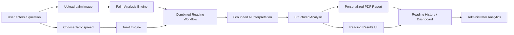

# 🔮 AI Palmistry & Tarot Intelligence Platform

An end-to-end student project that combines **palm-line analysis, Tarot card interpretation, and AI-generated natural-language insights** in a personalized reading experience. The platform brings together computer-vision output, structured Tarot knowledge, an LLM interpretation layer, downloadable PDF reports, user reading history, and an administrator analytics dashboard.

> **Purpose & Disclaimer:** This project is designed for learning, reflection, and entertainment. Palmistry and Tarot interpretations are symbolic and are not scientifically validated predictions. The output should not be treated as medical, legal, financial, or other professional advice.

## ✨ Project Highlights

- **Palm analysis:** Processes an uploaded palm image and produces an annotated image with detected Heart, Head, and Life lines.
- **Tarot intelligence:** Loads a 78-card Rider–Waite–Smith deck, draws a requested spread, and uses card keywords and meanings to build a reading.
- **Combined reading workflow:** Brings palm findings, the user's question, and selected Tarot cards together into one reading object.
- **Grounded AI interpretation:** Uses an LLM to turn the supplied reading facts into structured, readable insights rather than asking the model to invent card data.
- **Personalized PDF report:** Generates a report with source data, interpretation, personality intelligence, recommendations, and life-trend analysis.
- **User experience:** Includes onboarding, account access, a reading request form, reading results, personal dashboard, and reading history.
- **Administrator analytics:** Provides summary metrics, user/reading tables, filters, and charts for registration and reading activity.

## 🧭 System Workflow



**High-level flow:** image and question input → palm and Tarot processing → combined reading → AI interpretation → on-screen result and PDF report → reading history and administrative analytics.

The diagram describes the project workflow documented across the milestone reports. Exact production hosting, database technology, and API routes should be documented from the final source code and deployment configuration.

## 🏗️ System Architecture

The project is organized into functional layers. Module names below are taken from the milestone verification reports where available.

| Layer | Responsibility | Main components / artifacts |
|---|---|---|
| User interface | Guides users through onboarding, account access, palm upload, question entry, results, and reading history | Website UI shown in Milestone 4 |
| Palm analysis | Runs palm-line detection and produces an annotated palm image and line findings | `palm_engine.py`; the verified palmistry pipeline |
| Tarot engine | Loads card data, draws cards, and builds card-level meanings | `tarot_engine.py`; `tarot-images.json` |
| Reading orchestration | Combines palm analysis and Tarot output into one session-level reading | `reading_report.py`; `generate_combined_reading()` |
| AI interpretation | Builds a prompt grounded in the combined reading, calls the LLM, parses structured output, and handles fallback responses | `ai_interpretation_engine.py` |
| Report generation | Converts source data and AI analysis into a personalized PDF | `dashboard_report.py`; `dashboard_report.pdf` |
| User dashboard | Presents previous readings and account-related features | Milestone 4 user interface |
| Admin analytics | Summarizes user and reading activity with tables, filters, KPIs, and charts | Milestone 4 administrator dashboard |

### AI interpretation output

The report-generation workflow documents five principal sections:

1. **Source Data** — the question, palm-line findings, and selected Tarot cards.
2. **Interpretation** — a combined narrative based on the supplied findings.
3. **Personality Intelligence** — summarized strengths, weaknesses, and tendencies.
4. **Recommendations** — reflective suggestions related to the question.
5. **Life Trend Analysis** — opportunities, challenges, and growth themes.

The AI engine is designed to ground its analysis in the supplied palm and Tarot data. Its JSON parsing was tested with Markdown-fenced JSON, and a fallback result shape is available when the LLM response cannot be used.

## 📚 Datasets

The exploratory data analysis milestone examined three datasets.

### 1. Hand and palm metadata — `HandInfo.csv`

| Property | Reported finding |
|---|---|
| Rows and columns | 11,076 rows × 9 columns |
| Unique subjects | 190 |
| Missing values / duplicates | 0 / 0 |
| Dorsal images | 5,680 (51.3%) |
| Palmar images | 5,396 (48.7%) |
| Palmar right / left | 2,813 / 2,583 |
| Image dimensions | 1600 × 1200 pixels throughout the audited palmar set |

**Preprocessing findings from Milestone 1:**

- Dorsal images were removed from the palm-line analysis working set because palm-line detection requires the palm-facing side.
- The pixel-level audit flagged 107 images as too dark and 54 as blurry: **161 of 5,396 palmar images (3.0%)** in total, with no overlap between these groups.
- The report identifies subject-level leakage as a risk. Any model evaluation split should group images by subject ID rather than randomly splitting rows.
- Gender and skin-tone distributions are imbalanced, and the source images appear more controlled than typical in-the-wild phone captures. These are potential generalization concerns.

### 2. Tarot card knowledge — `tarot-images.json`

The project uses a structured Tarot dataset representing a complete **78-card Rider–Waite–Smith deck**.

| Property | Reported structure |
|---|---|
| Major Arcana | 22 cards |
| Minor Arcana | 56 cards |
| Suits | Cups, Swords, Wands, Pentacles |
| Suit counts | 14 cards per Minor Arcana suit |
| Card information | Keywords, meanings, and arcana-specific symbolic fields |

The EDA report notes that some fields are intentionally present only for particular arcana groups. These should be treated as schema differences, not automatically interpreted as missing data. Keyword and meaning text should be normalized before exact keyword-based lookup.

### 3. Palm image quality audit

The palm-image audit examined all **5,396 palmar images** individually using OpenCV-based image checks, including grayscale brightness and a Laplacian-variance blur score. The audit found no unreadable files and uniform image dimensions. The reported quality flags are useful preprocessing findings, not a claim that every possible image-quality issue has been eliminated.

> **Dataset availability:** The reports describe dataset names and audit results, but do not provide public download URLs or redistribution permissions. Do not upload the original image dataset or personal palm images to this repository unless you have the rights and appropriate consent. Add dataset citations and access instructions only after confirming the original sources and their licenses.

## 🔬 Development Milestones

### Milestone 1 — Exploratory Data Analysis
- Profiled hand/palm metadata, image quality, and Tarot card content.
- Audited the palmar images for readability, resolution, brightness, and blur.
- Identified subject leakage, class imbalance, and dataset generalization concerns.
- Defined preprocessing recommendations for later stages.

### Milestone 2 — Palm Analysis & Tarot Intelligence
- Verified the Tarot engine can load the real 78-card dataset, draw cards, and generate keyword/meaning text.
- Verified palm-line analysis with an annotated output image.
- Tested the combined palm + Tarot reading workflow and PDF export.
- Fixed a PDF rendering issue that had removed a Tarot card header line.

### Milestone 3 — AI Interpretation & Personalized Dashboard
- Added an LLM interpretation layer grounded in the combined reading data.
- Tested prompt construction and JSON parsing, including fenced JSON responses.
- Added a fallback response shape for unsuccessful or unusable LLM responses.
- Verified the end-to-end workflow could produce a personalized dashboard PDF with the five sections listed above.

### Milestone 4 — Website UI & Administrator Dashboard
- Documented the user journey: introduction, “How It Works,” account access, question entry, palm upload, reading results, and reading history.
- Added profile/account settings and a personal dashboard view.
- Presented administrative summaries, recent user/reading tables, filters, and analytics visualizations.

## 🧰 Technology Stack

Technologies explicitly evidenced by the milestone reports include:

- **Python** — project logic and workflow orchestration
- **OpenCV (`cv2`)** — palm image quality checks
- **Google GenAI / Gemini** — LLM-based interpretation
- **JSON** — structured Tarot card data and AI response parsing
- **PDF report generation** — personalized reading/dashboard exports

The reports reference a website interface and an administrator dashboard. Confirm the exact frontend framework, backend framework, database, authentication provider, and hosting service against the current source code before listing them as implemented technologies.

## 📂 Key Modules and Artifacts

The milestone reports name the following project modules:

```text
project/
├── palm_engine.py
├── tarot_engine.py
├── reading_report.py
├── ai_interpretation_engine.py
├── dashboard_report.py
├── milestone3_pipeline.py
└── Datasets/
    └── Data Files/
        └── tarot-images.json
```

This is a **conceptual module map**, not a guarantee of the repository's exact folder structure. Adapt it to match the current project files before publishing.

| Module / artifact | Role |
|---|---|
| `palm_engine.py` | Palm-analysis integration |
| `tarot_engine.py` | Tarot deck loading, card draws, and card-level reading content |
| `reading_report.py` | Combined reading workflow and report generation |
| `ai_interpretation_engine.py` | Grounded LLM prompt and structured interpretation |
| `dashboard_report.py` | Personalized analysis PDF |
| `milestone3_pipeline.py` | Orchestrates the end-to-end Milestone 3 workflow |
| `tarot-images.json` | Structured Tarot deck data |

## ⚙️ Setup and Configuration

The milestone reports do not include a complete, authoritative dependency lockfile or a verified public deployment recipe. Use the actual repository's `requirements.txt` or `pyproject.toml` if available rather than installing guessed versions.

### 1. Clone the repository

```bash
git clone <YOUR_GITHUB_REPOSITORY_URL>
cd <YOUR_REPOSITORY_FOLDER>
```

### 2. Create and activate a virtual environment

```bash
python -m venv .venv
```

Windows PowerShell:

```powershell
.venv\Scripts\Activate.ps1
```

macOS / Linux:

```bash
source .venv/bin/activate
```

### 3. Install the project's declared dependencies

```bash
pip install -r requirements.txt
```

If the repository does not yet contain a dependency file, create one from the verified environment before asking other users to reproduce the project.

### 4. Configure the LLM credential

If the current code calls Gemini, configure the API key using the environment-variable name expected by the code. Do not commit API keys, passwords, database credentials, or `.env` files.

Example `.env` pattern (replace the variable name with the one actually read by the application):

```text
GEMINI_API_KEY=replace_with_your_key
```

### 5. Check dataset paths

Make sure the Tarot JSON path and palm image/code paths match your local configuration. The Milestone 2 report notes that local hardcoded paths were a cleanup item, so paths should be made configurable before sharing the project.

### 6. Run the application

Use the actual entry point and run command defined in the repository. The milestone reports name `milestone3_pipeline.py` as the Milestone 3 orchestration module, but do not establish a final universal command for launching the Milestone 4 website.

## 🧪 Verification and Testing

Verification described in the milestone reports includes:

- Loading the Tarot dataset and drawing real cards.
- Running palm analysis and producing an annotated image with detected lines.
- Combining palm and Tarot results into one reading object.
- Generating a PDF report from the combined reading.
- Testing AI prompt construction and parsing JSON enclosed in Markdown fences.
- Checking that a fallback-shaped AI response can still be rendered into a report.
- Reviewing the user interface and administrator analytics through screenshots.

These are documented milestone checks, not a claim of exhaustive automated test coverage or production-scale stress testing.

## ⚠️ Known Limitations and Future Improvements

The reports identify or imply the following next steps:

- **Broader evaluation:** test more palm images, lighting conditions, skin tones, and Tarot questions.
- **Subject-wise evaluation:** prevent the same subject from appearing across training and test sets if image models are trained.
- **Path configuration:** replace machine-specific absolute paths with configurable paths.
- **Robust LLM parsing and diagnostics:** improve visibility into API failures and handle unusual response formats.
- **Privacy and security:** secure account handling, protect uploaded palm images, restrict administrator access, and avoid exposing user records.
- **Reproducibility:** add dependency versions, setup instructions, test commands, and a sanitized example configuration.
- **Deployment verification:** document the actual serving framework, hosting setup, API endpoints, and persistence layer from the final code.
- **Responsible communication:** make it clear that interpretations are reflective/entertainment content rather than evidence-based predictions.

## 🔐 Privacy and Responsible Use

Palm images and reading histories may be personal data. A public repository should contain only code, documentation, and sample assets that are safe to share. Keep private datasets, real user uploads, account exports, credentials, and production logs out of version control. Use a `.gitignore` file and review commits before pushing.

Suggested `.gitignore` entries (adapt to your project):

```gitignore
.env
.venv/
__pycache__/
*.py[cod]
*.log
uploads/
user_data/
*.sqlite3
```

Only ignore database files if that matches the actual storage configuration. Never publish a real database or user export merely because it is useful for a demo.

## 👨‍💻 Author

**Sourish Halder**  
Student Project — AI Palmistry & Tarot Intelligence Platform

## 📄 Project Documentation

The project was developed and verified across four milestone reports:

- **Milestone 1:** Exploratory Data Analysis
- **Milestone 2:** Palm Analysis & Tarot Intelligence
- **Milestone 3:** AI Interpretation Engine & Personalized Dashboard
- **Milestone 4:** Website User Interface & Administrator Dashboard

---

⭐ If you find the project interesting, feel free to explore the code and provide constructive feedback. Please preserve dataset licenses and user privacy when reproducing the workflow.
"""

out = "/mnt/data/README.md"
pypandoc.convert_text(readme, "md", format="md", outputfile=out, extra_args=["--standalone"])
print({"readme": out, "bytes": os.path.getsize(out)})

